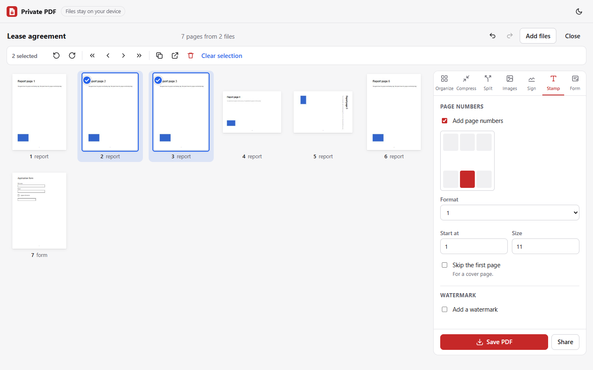

# Private PDF

PDF tools that run entirely on your device. Merge, split, compress, sign, fill and convert PDFs without uploading them anywhere.

**[Open Private PDF](https://stravix86.github.io/private-pdf/)**



## Download

| Platform | |
| --- | --- |
| Web | [stravix86.github.io/private-pdf](https://stravix86.github.io/private-pdf/), and it can be installed as an app from the browser |
| Windows | [PrivatePDF-windows.exe](https://github.com/Stravix86/private-pdf/releases/latest/download/PrivatePDF-windows.exe) (portable, no installer) |
| Android | [PrivatePDF-android.apk](https://github.com/Stravix86/private-pdf/releases/latest/download/PrivatePDF-android.apk) |

The Windows app uses the WebView2 runtime that ships with Windows 10 and 11. On Android, allow installs from your browser or file manager when prompted. The app then appears under "Open with" and "Share" for PDFs.

## Features

- **Merge** PDFs and images into one file, in any order.
- **Organize pages**: drag to reorder, rotate, delete, duplicate, insert blank pages, reverse.
- **Compress** at four levels. Balanced and Strong recompress photos and scans while keeping text sharp and searchable; Maximum turns pages into images for the smallest size.
- **Split and extract**: one file per page, every N pages, custom ranges such as `1-3, 4, 5-9`, or just the selected pages. Multiple files are saved as a single .zip.
- **Sign**: draw, type or upload a signature (the paper background is removed automatically) and place it on any page. Signatures can be saved on the device for next time.
- **Add text, dates, ticks and crosses** anywhere on a page, and white-out boxes to cover content.
- **Fill forms**: complete text fields, checkboxes, dropdowns and radio buttons, and optionally lock the answers.
- **Page numbers and watermarks**, with a live preview on every page.
- **Images to PDF** (JPG, PNG, WebP, GIF, BMP; phone photos are turned the right way up) and **PDF to images** (JPG or PNG at 72, 150 or 300 dpi).
- **Remove hidden information** such as author, software and dates stored inside the file.
- Opens password-protected PDFs. Protected or damaged files that can't be edited directly are saved with their pages as images.
- Zoom: make page thumbnails bigger or smaller, and zoom up to 600% in the page editor with the buttons, Ctrl + mouse wheel or a pinch, then drag to move around.
- Undo and redo for page changes, keyboard shortcuts, light and dark themes, works offline.

## Privacy

Files are read and written in the browser tab, or inside the Windows or Android app. Nothing is sent to a server, there is no account, and there is no analytics. The only thing stored is what you choose to keep: saved signatures and your theme, in the browser's local storage.

## Keyboard shortcuts

| Keys | Action |
| --- | --- |
| Ctrl+S | Save PDF |
| Ctrl + / Ctrl - | Larger or smaller pages; zoom in or out in the page editor |
| Ctrl+0 | Reset the page size, or fit the page in the editor |
| Ctrl + mouse wheel | Same as Ctrl + and Ctrl - (pinch works on touch screens and trackpads) |
| Ctrl+Z / Ctrl+Y | Undo / redo |
| Ctrl+A | Select all pages |
| Delete | Delete selected pages (or the selected item in the page editor) |
| Shift+click | Select a range of pages |
| Esc | Clear selection, or close the page editor |

## How it works

- Plain HTML, CSS and JavaScript modules with no build step.
- [pdf.js](https://github.com/mozilla/pdf.js) (Mozilla, Apache 2.0) draws pages, and [pdf-lib](https://github.com/Hopding/pdf-lib) (MIT) writes the output. Both are included in `vendor/` and load only after you open a file.
- When the page order of a single document is unchanged, it is edited in place, so bookmarks, links and form fields are kept. Otherwise pages are copied into a new document, sharing fonts and images between pages.
- Compression decodes each embedded JPEG or uncompressed image, scales it down if it's very large, re-encodes it as JPEG, and keeps the result only if it is noticeably smaller.
- The Windows app is a [Tauri](https://tauri.app) wrapper (about 3 MB). The Android app is a small native WebView wrapper. Both are built by GitHub Actions (`.github/workflows/build-apps.yml`) when a version tag is pushed.

## Running locally

Serve the folder with any static file server, for example:

```bash
python -m http.server 8000
```

Then open http://localhost:8000. (Opening `index.html` directly from disk won't work, because browsers block modules and workers on `file://` pages.)

## Licence

MIT. See [LICENSE](LICENSE). pdf.js is Apache 2.0 and pdf-lib is MIT; their licences are in `vendor/`.
